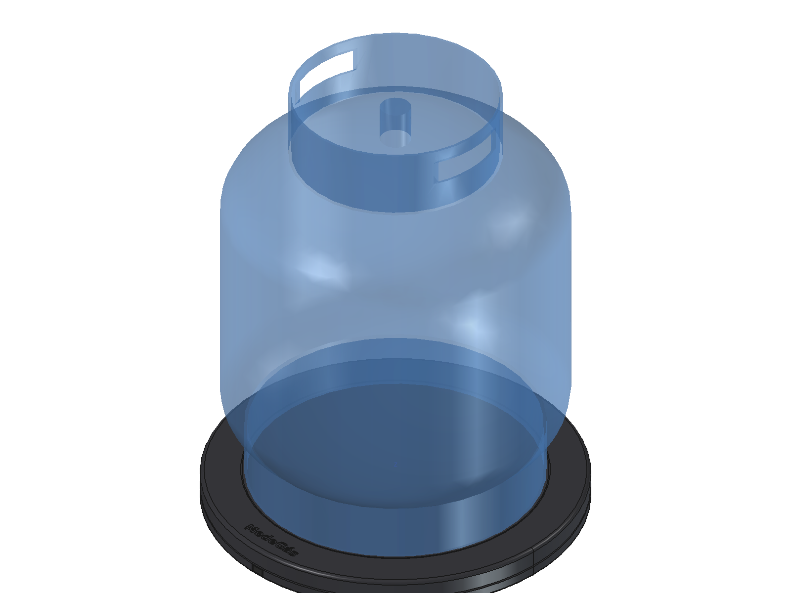

# MedeGás — protótipo mecânico (FreeCAD)

Plataforma IoT de pesagem para botijão P13: mede o peso e estima o GLP restante. **Não** é detector de vazamento.

> **Status v0.1 — PRELIMINAR.** Geometria paramétrica completa e verificada contra interferências, mas várias
> cotas dependem de medidas reais (botijão, sensores, eletrônica) marcadas como PENDENTE. Nada aqui está liberado
> para uso com botijão cheio — ver [docs/riscos-e-validacoes.md](docs/riscos-e-validacoes.md).



## Arquivos

| Caminho | Conteúdo |
|---|---|
| `freecad/MedeGas_Mestre.FCStd` | A e B lado a lado com botijão de referência + vistas explodidas |
| `freecad/MedeGas_Arquitetura_A.FCStd` | 4 sensores de meia ponte: montagem, explodida (links), cortes, 3 folhas TechDraw, lista de peças, parâmetros |
| `freecad/MedeGas_Arquitetura_B.FCStd` | Célula single-point: idem |
| `freecad/parts/` | Peças fabricadas como FCStd individuais |
| `freecad/fem/` | Análises FEM (abrir no FreeCAD, workbench FEM) |
| `freecad/exports/{step,stl,dxf,pdf,png}` | Intercâmbio, impressão, corte de chapa, desenhos, imagens — tudo `PRELIMINAR_` (ver `exports/MANIFESTO.md`) |
| `scripts/params.py` | **Fonte única** dos parâmetros, cada um com status CONFIRMADO / HIPÓTESE / PENDENTE |
| `scripts/medegas_lib.py` | Geometria de todas as peças |
| `scripts/checks.py` | Interferências, caminho de carga, tombamento |
| `scripts/fem_study.py` | Estudo FEM (CalculiX) da placa superior |
| `validation/` | Relatórios gerados (interferências, FEM) + checklist de ensaios |
| `docs/` | Conceito, especificações, comparação A×B, materiais, montagem, riscos, lista de materiais |

## Regenerar tudo

Requer FreeCAD ≥ 1.1 (testado com 1.1.3 do conda-forge) e, em servidor sem tela, `xvfb-run`.

```bash
FREECAD_BIN=/caminho/para/freecad/bin ./scripts/run_all.sh
```

Mudar parâmetros sem editar arquivo:

```bash
MEDEGAS_SET="D_ext=380,r_sens=145,sens_H=7.5" ./scripts/run_all.sh --sem-fem
```

No FreeCAD com tela: *Macro → Executar* em `scripts/create_architecture_a.py` (não fecha o programa fora do modo
lote). O modelo é paramétrico **pelo script**: as peças no FCStd são formas estáticas, a planilha `Parametros` é
espelho de leitura. Para mudar, edite `params.py` e regenere.

## Ambiente usado nesta versão

- FreeCAD 1.1.3 (conda-forge, `micromamba create -p /opt/fc -c conda-forge freecad=1.1.3 calculix`), Gmsh, CalculiX.
- `freecadcmd` para geometria/FEM/exportação; `freecad` sob `xvfb-run` para cores, PNG e PDF.
- Limitações encontradas e contornadas (documentadas nos scripts): câmera do modo offscreen corta o modelo
  (câmera explícita em `render.py`); PDF do TechDraw só sai com moldura com a página aberta na GUI; remover folhas
  TechDraw com a GUI aberta derruba o FreeCAD (por isso os FCStd são sempre regerados); o gravador de pressão do
  FEM perdia ~45% da carga em faixas anelares (carga reescrita como forças nodais, conferida pela soma das reações).

## Principais achados da v0.1

Ver [docs/comparacao-sensores.md](docs/comparacao-sensores.md) e `validation/`.

- Zero interferências nas duas arquiteturas; menor folga entre lado pesado e solo = batente (0,8 mm).
- A: 36,5 mm de altura, placa de 3 mm suficiente nos casos centrado/excêntrico (flecha 0,23–0,33 mm).
- FEM mudou o projeto: batentes da A saíram da borda entre sensores (consumiam até 127% da folga) para o eixo de
  cada sensor (≤3%).
- B: 46,5 mm (fora da faixa 30–45), placa de 3 mm insuficiente; com 6 mm os batentes encostam em uso normal.
- Plataforma reduz levemente o ângulo de tombamento (34° → ~32°) — validar em ensaio.
- Nenhuma arquitetura escolhida: faltam medidas e ensaio de erro de canto.
